<h1 align="center">Hi, I'm Alp 👋</h1>

  I build apps, trackers and hackathon prototypes. 
  Control & Automation Engineering @ ITU · Erasmus @ Uni Kassel 🇩🇪

  

### 🛠 Tools I reach for

### 🚀 Things I've built

| | |
|---|---|
| 📱 **[SecondBrainCapture](https://github.com/crystalfruit2/SecondBrainCapture)** | iOS app that sends voice and text notes straight into my Obsidian vault |
| 🔥 **[BioGuard](https://github.com/crystalfruit2/bioguard-docs)** | Fire & life safety for the buildings nobody protects · Honeywell FutureShapers Hackathon 2026, Bucharest |
| 🎯 **[DARE-MOT](https://github.com/crystalfruit2/DARE-MOT)** | Multi-object tracker, research project with a paper in preparation |
| 🌐 **[deniz-eldam-site](https://deniz-eldam-site.vercel.app)** | Author website, live on Vercel |

### 🏆 Hackathons
- 🥉 Siemens Healthineers Hackathon 2026, Erlangen
- Honeywell FutureShapers 2026, Bucharest (BioGuard)

  
  

